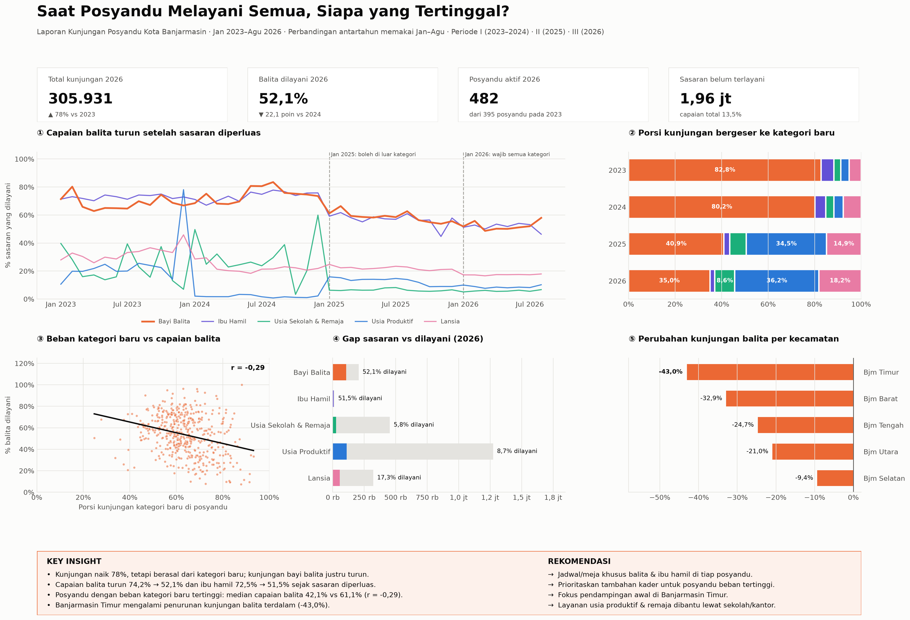
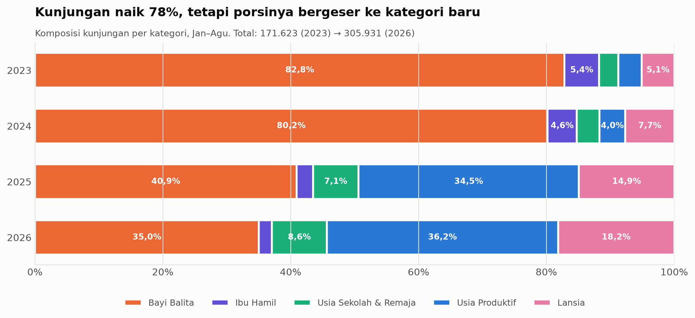
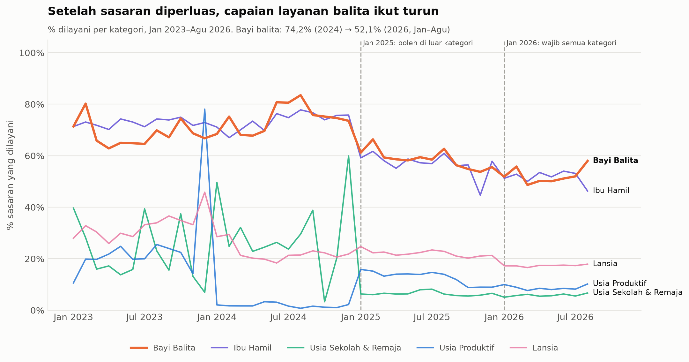
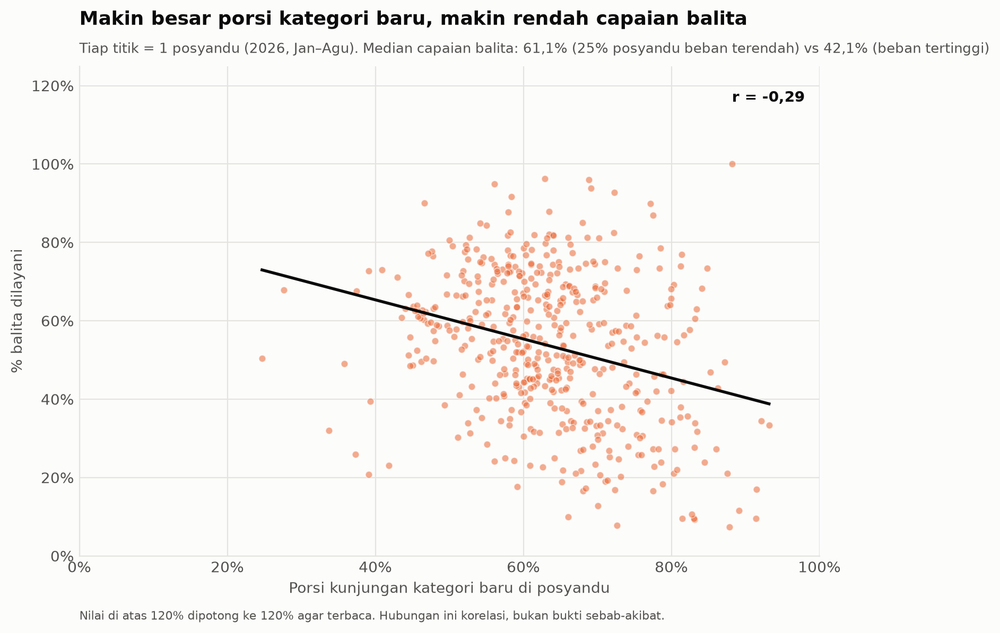
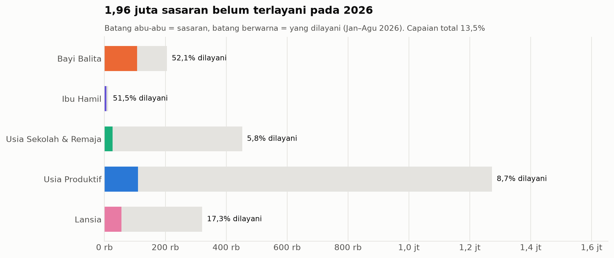
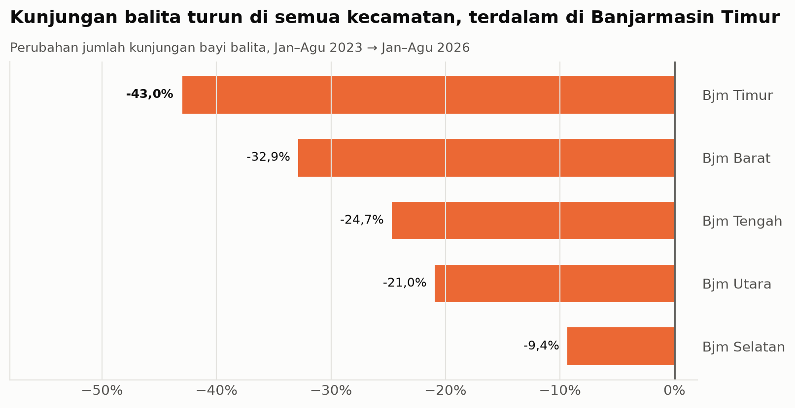
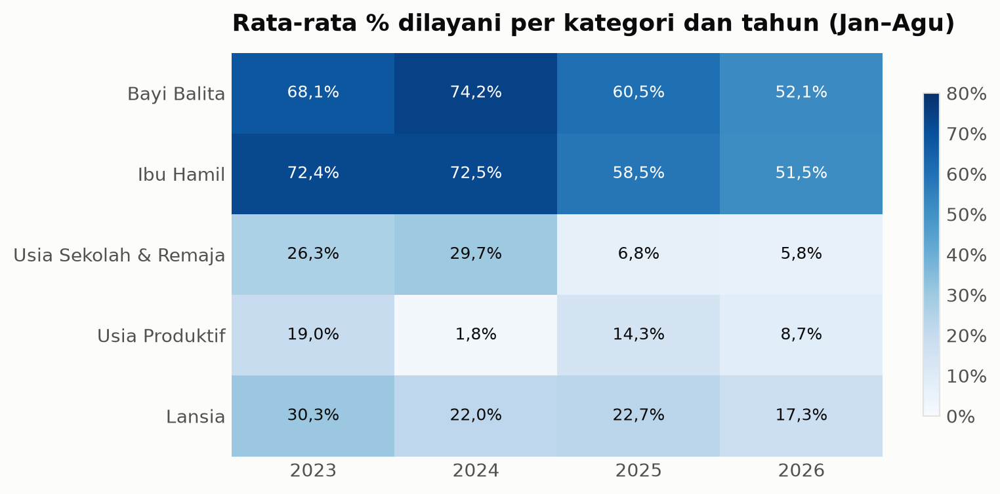
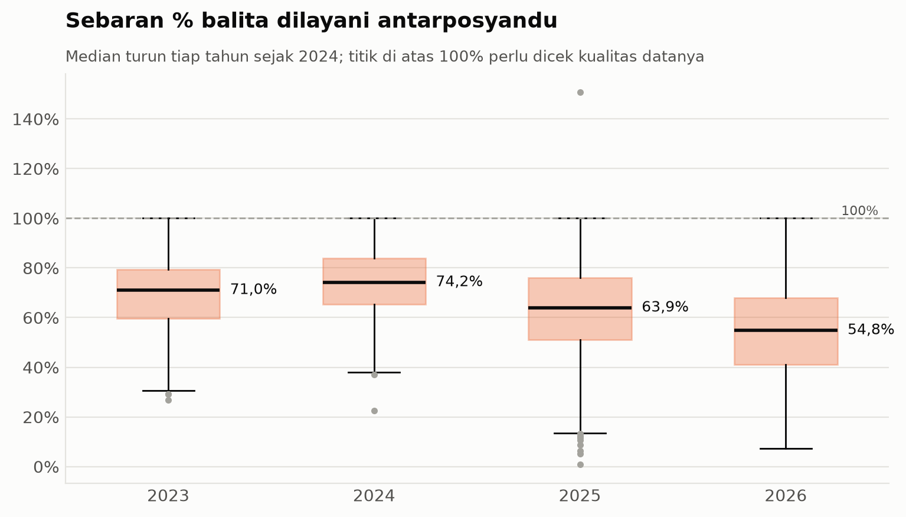

# Saat Posyandu Melayani Semua, Siapa yang Tertinggal?

**Visualisasi Perubahan Kunjungan Posyandu di Kota Banjarmasin Tahun 2023–2026 Berdasarkan Periode Kebijakan Sasaran Pelayanan**

Project UAS mata kuliah **Visualisasi Data** · Program Studi Teknologi Informasi, Fakultas Teknik, Universitas Lambung Mangkurat

**Muhammad Dzul Fathi Ahyan** · NIM 2410817210011


---

## Daftar Isi
1. [Problem](#1-problem)
2. [Dataset](#2-dataset)
3. [Tools](#3-tools)
4. [Alur Pengolahan Data](#4-alur-pengolahan-data)
5. [Dashboard](#5-dashboard)
6. [Key Insights](#6-key-insights)
7. [Recommendation](#7-recommendation)
8. [Struktur Repository](#8-struktur-repository)
9. [Cara Menjalankan](#9-cara-menjalankan)
10. [Catatan Privasi Data](#10-catatan-privasi-data)

---

## 1. Problem

Kebijakan **Integrasi Layanan Primer (ILP)** mengubah posyandu dari layanan yang berfokus pada ibu hamil dan balita menjadi layanan untuk **seluruh siklus hidup**. Di Kota Banjarmasin, aturan sasaran pelayanan berubah tiga kali:

| Periode | Tahun | Aturan pelayanan |
|---|---|---|
| **I** | 2023–2024 | Hanya melayani kategori sasaran tertentu |
| **II** | 2025 | Boleh melayani sasaran di luar kategorinya |
| **III** | 2026 | Wajib melayani semua kategori sasaran |

Kalau data digabung tanpa memperhatikan periode kebijakan, kenaikan jumlah kunjungan pada 2025–2026 akan terbaca sebagai **peningkatan kinerja**. Padahal kenaikan itu sebagian besar berasal dari kategori baru yang memang baru boleh dilayani. Selain itu, data laporan berbentuk tabel lebar (305 kolom per tahun) sehingga pola perubahannya sulit dilihat dari angka mentah.

**Pertanyaan analitik:**
1. Bagaimana perubahan kunjungan tiap kategori sasaran dari 2023 hingga 2026?
2. Bagaimana perbedaan komposisi kunjungan dan capaian layanan antarperiode kebijakan?
3. Kategori sasaran dan kecamatan mana yang capaian layanannya masih rendah setelah sasaran diperluas?

---

## 2. Dataset

| Keterangan | Isi |
|---|---|
| Nama | Laporan Kunjungan Posyandu Kota Banjarmasin 2023–2026 |
| Sumber | Data primer laporan pelayanan posyandu (bukan repositori publik) |
| Cakupan wilayah | 5 kecamatan · 52 kelurahan · 27–28 puskesmas · 395–490 posyandu |
| Periode analisis | **Januari 2023 – Agustus 2026** (September 2026 baru terisi sebagian) |
| Bentuk asli | 4 sheet tahunan, 305 kolom (5 identitas + 12 bulan × 5 kategori × 5 indikator) |
| Hasil olahan | **96.220 observasi** format panjang (posyandu × bulan × kategori) |
| Kategori sasaran | Ibu Hamil · Bayi Balita · Usia Sekolah dan Remaja · Usia Produktif · Lansia |
| Indikator | Sasaran · Cakupan · % Dilayani · Dirujuk · % Dirujuk |

> ⚠️ **Dataset tidak diunggah** ke repository ini karena merupakan data pelayanan kesehatan milik pemerintah. Lihat [Catatan Privasi Data](#10-catatan-privasi-data).

---

## 3. Tools

| Tools | Peruntukan |
|---|---|
| Microsoft Excel | Pemeriksaan data awal (sel kosong, nilai negatif, % > 100) |
| Python (pandas, numpy, openpyxl) | Mengubah tabel lebar ke format panjang, cleaning, menghitung KPI |
| Python (matplotlib) | Visualisasi yang bisa direproduksi untuk dokumentasi |
| Tableau | Dashboard interaktif final |
| Jupyter Notebook | Lingkungan pengolahan dan visualisasi |

---

## 4. Alur Pengolahan Data

```
Raw (4 sheet, 305 kolom)
  → Reshape ke format panjang (96.220 baris)
  → Cleaning
  → KPI & agregasi
  → Visualisasi (Python & Tableau)
  → Insight
```

**Aturan cleaning:**
1. Data dibatasi **Jan 2023 – Agu 2026**.
2. Posyandu diidentifikasi dengan **Kecamatan + Kelurahan + Nama**, karena ada posyandu yang namanya sama.
3. **72 nilai Dirujuk negatif** dianggap kosong.
4. **% Dilayani dihitung ulang** = Cakupan ÷ Sasaran × 100. Nilai > 100% **ditandai**, tidak dibuang.
5. Kolom **Dirujuk 2023 tidak dipakai**, karena kosong sepanjang tahun.

**Metode perhitungan:**
- Persentase agregat = **Σ Cakupan ÷ Σ Sasaran** (rata-rata tertimbang, bukan rata-rata persen per posyandu).
- Perbandingan antartahun memakai bulan yang sama, yaitu **Januari–Agustus**.

---

## 5. Dashboard

Dashboard dibangun di **Tableau** dan terdiri dari dua halaman.

### Dashboard Utama


Isi dashboard utama:
- **4 KPI card**: total kunjungan, % balita dilayani, posyandu aktif, sasaran belum terlayani
- **5 visualisasi**, masing-masing menjawab satu insight
- **Kotak Key Insight & Rekomendasi**

Interaktivitas:
- Filter **Kecamatan** (berlaku untuk seluruh dashboard)
- *Highlight* kategori
- Klik bar kecamatan untuk memfilter dashboard
- Tombol navigasi ke halaman detail

### Dashboard Detail & Kualitas Data


### Ringkasan Versi Python
Versi statis yang dihasilkan oleh `notebooks/02_visualisasi_posyandu.ipynb`.



### Pemilihan Chart

| Visualisasi | Jenis chart | Alasan pemilihan |
|---|---|---|
| Tren % dilayani | Garis multi-seri + garis penanda kebijakan | Data deret waktu; perubahan terlihat tepat setelah aturan berubah |
| Komposisi kunjungan | Batang bertumpuk 100% | Yang dibandingkan proporsi, bukan jumlah |
| Beban vs capaian balita | Scatter + garis tren | Menunjukkan hubungan dua variabel per posyandu |
| Gap sasaran | Batang horizontal (sasaran vs dilayani) | Selisih langsung terlihat dari panjang batang |
| Perubahan per kecamatan | Batang horizontal terurut | Membandingkan 5 wilayah dari penurunan terbesar |
| Capaian kategori × tahun | Heatmap | Dua dimensi terbaca sekaligus; sel rendah langsung terlihat |
| Sebaran antarposyandu | Boxplot | Menampilkan median, variasi, dan nilai ekstrem |

Warna tiap kategori konsisten di semua chart. Layanan inti (balita dan ibu hamil) memakai warna paling kuat. Diagram lingkaran tidak dipakai karena irisannya sulit dibandingkan untuk 5 kategori × 4 tahun.

---

## 6. Key Insights

### Insight 1: Kunjungan naik 78%, tetapi bukan dari layanan inti


| | |
|---|---|
| **What** | Total kunjungan naik dari **171.623** (2023) menjadi **305.931** (2026). Porsi bayi balita turun dari **82,8%** menjadi **35,0%**, sedangkan usia produktif naik dari **3,7%** menjadi **36,2%**. |
| **Why** | Sasaran pelayanan diperluas pada 2025 dan diwajibkan untuk semua kategori pada 2026. |
| **So What** | Total kunjungan tidak bisa langsung dibaca sebagai "kinerja posyandu membaik". |
| **Now What** | Evaluasi kinerja posyandu dipisah per kategori dan per periode kebijakan. |

### Insight 2 (utama): Layanan balita melemah setelah sasaran diperluas


| | |
|---|---|
| **What** | Kunjungan bayi balita turun **24,6%** (142.145 → 107.148), padahal jumlah sasarannya hampir tetap. % balita dilayani turun dari **74,2%** (2024) menjadi **52,1%** (2026), dan ibu hamil dari **72,5%** menjadi **51,5%**. |
| **Why (dugaan)** | Kader dan waktu layanan yang sama kini harus dibagi untuk lima kategori sasaran. |
| **So What** | Layanan gizi, imunisasi, dan deteksi dini stunting pada balita berisiko tertinggal. |
| **Now What** | Sediakan jadwal atau meja khusus balita dan ibu hamil, lalu pantau % dilayani balita setiap bulan. |

### Insight 3: Makin besar beban kategori baru, makin rendah capaian balita


| | |
|---|---|
| **What** | Pada 2026, posyandu dengan porsi kunjungan kategori baru tertinggi memiliki median capaian balita **42,1%**, dibanding **61,1%** pada posyandu dengan porsi terendah. Hubungannya negatif, lemah, tetapi signifikan (**r = −0,29; p < 0,0001**). |
| **Why** | Mendukung dugaan beban layanan pada Insight 2. Ini hubungan (korelasi), bukan bukti sebab-akibat. |
| **So What** | Posyandu yang paling berisiko bisa diidentifikasi. |
| **Now What** | Prioritaskan tambahan kader atau pendampingan puskesmas untuk posyandu dengan beban kategori baru tertinggi. |

### Insight 4: 1,96 juta sasaran belum terlayani


| | |
|---|---|
| **What** | Sasaran 2026 berjumlah **2,26 juta**, dan baru **13,5%** yang terlayani. Kategori dengan capaian terendah adalah **usia sekolah & remaja (5,8%)** dan **usia produktif (8,7%)**. Usia produktif menyumbang **59%** dari sasaran yang belum terlayani. |
| **Why** | Target sasaran naik sekitar 7,5 kali lipat sejak 2023, tanpa penambahan kapasitas yang sebanding. |
| **So What** | Target untuk kategori baru belum realistis jika hanya mengandalkan posyandu. |
| **Now What** | Layanan usia produktif dan remaja dibantu lewat sekolah, kantor, atau Posbindu, dan targetnya dikalibrasi ulang. |

### Insight 5: Penurunan terdalam di Banjarmasin Timur


| | |
|---|---|
| **What** | Kunjungan balita turun di **semua kecamatan**. Penurunan terdalam terjadi di **Banjarmasin Timur (−43,0%)**, terendah di Selatan (−9,4%). |
| **Why** | Sebagian penurunan di Timur berasal dari **8 posyandu yang tidak melaporkan data balita pada 2026**. Tanpa mereka pun, penurunannya tetap terdalam (−37,4%). |
| **So What** | Intervensi tidak perlu disamaratakan untuk satu kota. |
| **Now What** | Fokuskan pendampingan awal di Banjarmasin Timur, termasuk untuk kelengkapan pelaporan posyandunya. |

### Visualisasi Pendukung

| Heatmap % dilayani | Sebaran antarposyandu |
|---|---|
|  |  |

---

## 7. Recommendation

| Insight | Impact | Recommendation |
|---|---|---|
| Kenaikan kunjungan berasal dari kategori baru | Kinerja bisa disalahartikan | Evaluasi per kategori dan per periode kebijakan |
| Capaian balita & ibu hamil turun | Layanan inti posyandu tertinggal | Jadwal/meja khusus balita & ibu hamil; pantau bulanan |
| Beban kategori baru berhubungan dengan capaian balita | Posyandu beban tinggi paling berisiko | Tambahan kader dan pendampingan puskesmas |
| 1,96 juta sasaran belum terlayani | Target kategori baru tidak realistis | Kolaborasi sekolah/kantor/Posbindu; kalibrasi target |
| Timur turun paling dalam | Ketimpangan antarwilayah | Prioritas pendampingan & kelengkapan pelaporan di Timur |

---

## 8. Struktur Repository

```
VISDAT_Posyandu/
├── README.md
├── requirements.txt
├── .gitignore
├── notebooks/
│   ├── 01_cleaning_posyandu.ipynb     # reshape, cleaning, KPI
│   └── 02_visualisasi_posyandu.ipynb  # visualisasi Python
├── dashboard/
│   └── Dashboard_Posyandu.twb         # workbook Tableau (tanpa data)
├── outputs/
│   └── figures/                       # gambar visualisasi & screenshot dashboard
├── poster/
│   └── Poster_A3.png
└── data/                              # TIDAK diunggah (lihat .gitignore)
    ├── raw/
    └── processed/
```

---

## 9. Cara Menjalankan

> Notebook hanya bisa dijalankan jika memiliki akses ke data asli.

1. Install library:
   ```bash
   pip install -r requirements.txt
   ```
2. Taruh file `Laporan Kunjungan Posyandu.xlsx` di folder `data/raw/`.
3. Jalankan notebook secara berurutan:
   - `01_cleaning_posyandu.ipynb` → menghasilkan `data/processed/posyandu_long_clean.csv` dan tabel KPI di `outputs/tables/`
   - `02_visualisasi_posyandu.ipynb` → menghasilkan gambar di `outputs/figures/`
4. Buka `dashboard/Dashboard_Posyandu.twb` di Tableau, lalu arahkan sumber datanya ke:
   - `data/processed/posyandu_long_clean.csv`
   - `outputs/tables/beban_vs_balita.csv`

---

## 10. Catatan Privasi Data

Data laporan kunjungan posyandu adalah **data pelayanan kesehatan milik pemerintah** dan memuat nama posyandu, wilayah, serta data kader. Karena itu, repository ini **tidak menyertakan**:
- file Excel mentah dan CSV hasil olahan (`data/`)
- tabel KPI per posyandu (`outputs/tables/`)
- workbook Tableau berformat `.twbx` (karena membawa salinan data)

Yang diunggah hanya **kode**, **workbook Tableau tanpa data (`.twb`)**, dan **gambar visualisasi yang berisi angka agregat**.

---

**Referensi utama:** Kementerian Kesehatan RI, *Integrasi Layanan Primer melalui Posyandu*; C. N. Knaflic, *Storytelling with Data* (2015); S. Few, *Show Me the Numbers* (2012); T. Munzner, *Visualization Analysis and Design* (2014).
